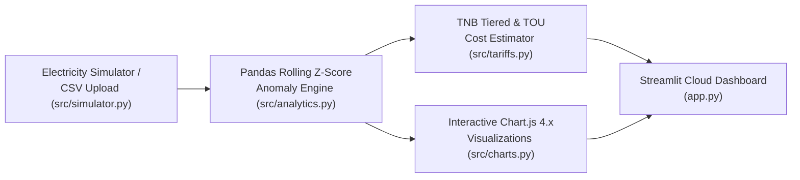

# Smart Energy Consumption Monitoring (by Muhammad Abdullahi Bukar)

A software-only energy analytics, cost estimation, and statistical anomaly detection platform built with **Python, Streamlit, Pandas, and Chart.js**.

Simulates realistic multi-appliance electricity consumption without physical hardware, computes estimated utility bills under tiered & time-of-use tariffs, and automatically flags abnormal power spikes using a rolling Z-score detector.

## Key Features

- **Multi-Appliance Electricity Simulator**: Models diurnal & weekend load curves across 5 appliance categories (`Air Conditioning`, `Refrigerator`, `Lighting`, `Water Heater`, `Home Office & IT`), supports live fault-spike injection, and accepts custom CSV meter uploads.
- **Interactive Chart.js Visualizations**: Embedded Chart.js 4.x time-series consumption chart (with rolling baseline and red anomaly markers), appliance share doughnut chart, and 24-hour peak-demand bar chart.
- **Electricity Cost & Savings Estimator**:
  - **Malaysia TNB Tiered Tariff (MYR)**, **Time-of-Use (Peak / Off-Peak)**, and **Custom Flat Rate** calculators.
  - 30-day projected bill, monthly budget utilization bar, and a **What-If AC reduction slider** to quantify potential savings.
- **Automated Anomaly Detection**: Pandas 24-hour rolling Z-score engine that flags `WARNING` and `CRITICAL` spikes, identifies the top contributing appliance, measures overnight phantom load (`01:00–05:00`), and exports full CSV reports.
- **Automated Testing & CI**: Pytest unit/integration test suite running automatically on every push & PR via GitHub Actions.

## Architecture



## Project Structure

```text
smart-energy-monitor/
├── .github/workflows/
│   └── ci.yml                  # Python 3.11 compile check + Pytest CI pipeline
├── .streamlit/
│   └── config.toml             # Dark theme & headless server configuration
├── src/
│   ├── simulator.py            # Multi-appliance kWh simulator & CSV loader
│   ├── tariffs.py              # Malaysia TNB Tiered, TOU & Custom cost calculator
│   ├── analytics.py            # Rolling Z-score anomaly detector & load analytics
│   └── charts.py               # Embedded Chart.js 4.x HTML/JS chart builders
├── tests/
│   └── test_energy_engine.py   # Pytest suite (simulator, tariffs, anomaly detection)
├── app.py                      # Main Streamlit application
├── requirements.txt
├── LICENSE
└── README.md
```

## Deploy Live Online (Free — Zero Local Setup)

1. Push this repository to GitHub.
2. Open [share.streamlit.io](https://share.streamlit.io) and sign in with GitHub.
3. Click **Create app** → select this repository → set **Main file path** to `app.py` → click **Deploy**.
4. Your live public app will be online in ~1 minute!

## Author

- **Muhammad Abdullahi Bukar**

## License

Licensed under the MIT License — see [LICENSE](LICENSE).
