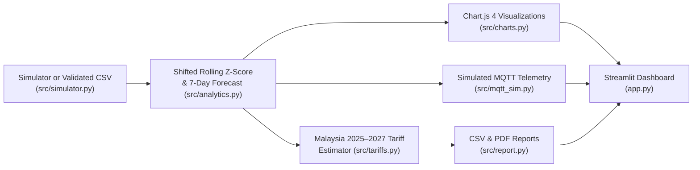

# Architecture & Design Notes

## Overview
Smart Energy Monitor is a **software-simulated IoT energy monitoring prototype** (no physical meter required). It models an end-to-end metering workflow from data ingestion through anomaly detection, cost estimation, MQTT topic telemetry, and PDF/CSV reporting.

## Data Flow

## Key Engineering Choices
- **Unbiased spike detection**: `total_kwh.shift(1)` is applied before computing the 24-hour rolling mean and standard deviation so a sudden power spike does not distort its own baseline.
- **Units separation**: Energy consumed is reported in `kWh` (e.g., last hour energy, period total), while average power is computed as `total_kwh / elapsed_hours` in `kW`.
- **CSV validation**: Uploaded files are validated for invalid timestamps, duplicate timestamps, missing/non-numeric readings, negative values, and irregular time gaps before cost projection.
- **Configurable tariff estimation**: Reflects Malaysia's July 2025–2027 residential tariff components (Energy, Capacity, Network, AFA, and Monthly Retail Charge waived at <= 600 kWh), with all rates editable in the sidebar and clearly marked as estimates.
